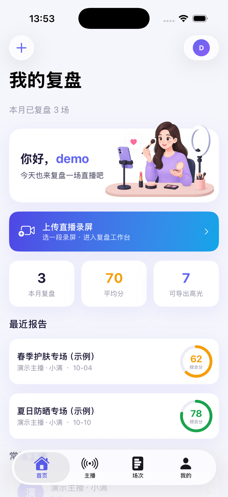
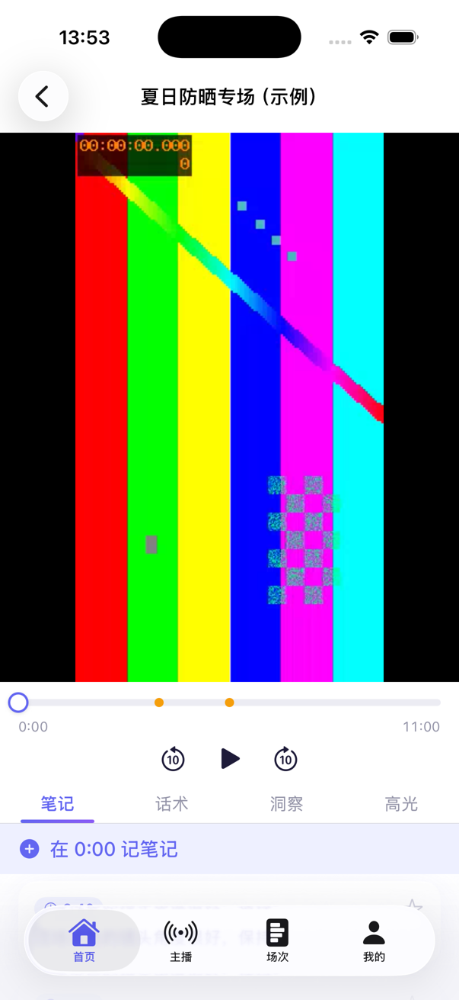
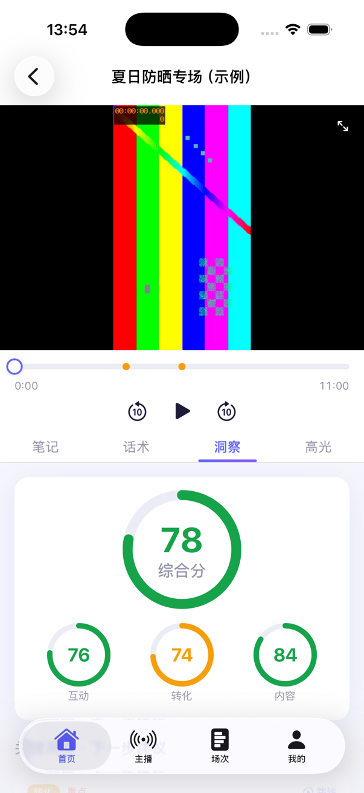
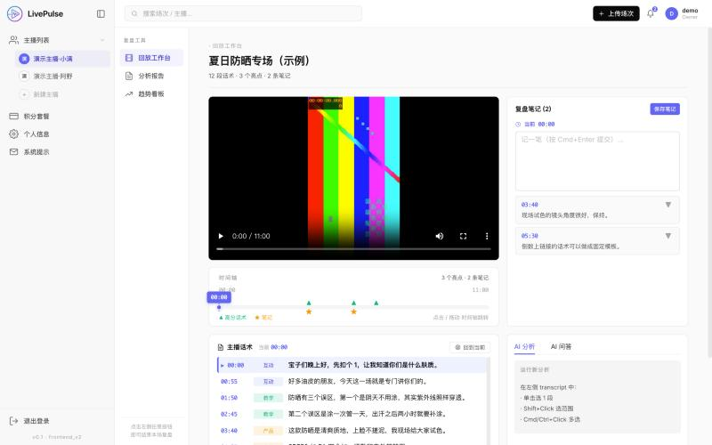
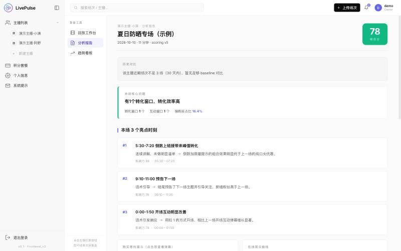
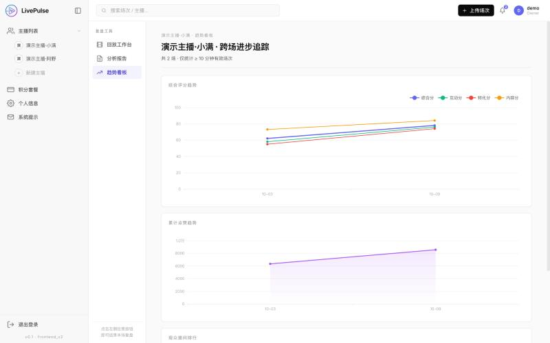
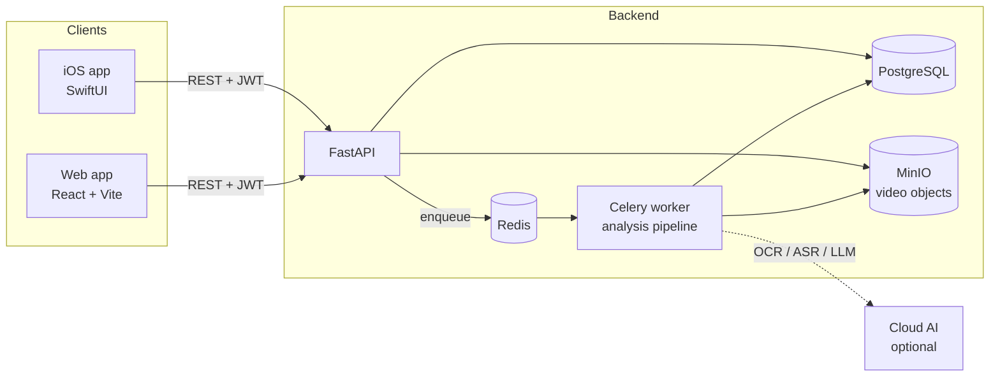

# LivePulse · 脉播

**A coaching-style AI review tool for live-stream replays.** Upload a screen recording of a live session; get a score, the moments that mattered, and concrete next steps — instead of re-watching hours of footage.

[English](README.md) · [简体中文](README.zh-CN.md) · [MIT License](LICENSE)

<p align="center">
  
  
  
</p>
<p align="center">
  
  
  
</p>

> All screenshots show **synthetic demo data** (fictional streamers, invented scripts, a generated test-pattern video). No real streamer or platform data is included in this repository.

## What it does

- **Review workspace** — video player, a timeline with highlight and note markers, a windowed transcript, and AI insights, side by side.
- **Coaching report** — composite score plus engagement / conversion / content sub-scores, the key moments, and what to change next time.
- **Highlights** — AI-picked shareable moments, exportable as clips.
- **Progress across sessions** — a per-streamer trend view so you can see whether you are actually improving.
- **Time-anchored notes** — pin notes to the timeline; synced to the backend.

Two clients share one backend: a native **iOS app** (SwiftUI) and a **web app** (React).

## Try it in three commands (no API keys needed)

Demo mode seeds a few fully synthetic, already-analysed sessions and generates a short sample video. It never calls any cloud AI service.

```bash
git clone https://github.com/kongdezheng347104464-ship-it/livepulse-review.git && cd livepulse-review/livepulse-backend
docker compose -f docker-compose.demo.yml up --build        # backend + db + object storage
cd frontend_v2 && npm install && npm run dev                 # web app on http://localhost:3002
```

Log in with `demo@example.com` / `demo-password-123` (a public, local-only demo account).

- The first build downloads PyTorch and friends and takes roughly 10–40 minutes depending on your connection (the log goes quiet during large downloads — that is normal). The first start also generates an 11-minute sample video (~35 MB, never committed).
- On a slow connection to PyPI: `docker compose -f docker-compose.demo.yml build --build-arg PIP_INDEX_URL=https://mirrors.aliyun.com/pypi/simple/`
- **iOS:** open `livepulse-app/LivePulse/LivePulse.xcodeproj` in Xcode and run on a simulator. Debug builds talk to `http://127.0.0.1:8000`.

## Architecture



Videos upload in chunks and are served back to clients through presigned, range-capable URLs. Analysis runs out of band in a worker, so a user can open the workspace and start watching while results arrive.

## The analysis pipeline

One recording goes through a small graph of steps ([`tasks/pipeline.py`](livepulse-backend/backend/app/tasks/pipeline.py)):

```
Phase 1 (sequential)   video processing → frames + segments
Phase 2 (parallel)     ASR branch: asr → script analysis → early insights → tactics
                       OCR branch: ocr → viewer count → danmaku analysis
Phase 3 (sequential)   correlation → scoring → playback re-encode
```

What is worth a look:

- **Two-level failure model.** A step raises `StepError` when it is fatal for the session and `StepSkipped` when the pipeline can degrade gracefully (for example, no audience-count series just falls back to simpler metrics). The orchestrator treats them differently.
- **Parallel branches that share one DB session.** The ASR and OCR branches run under `asyncio.gather`; compute-heavy work overlaps in threads while database writes are serialized behind a lock. On a 16-minute video the author measured ~46 s (ASR) and ~31 s (OCR) running concurrently instead of ~77 s in sequence.
- **Per-step tracking.** Every step records status, timing and errors in its own table, so a failed run is diagnosable after the fact. Sessions stuck in a locked state with no live worker are marked `error` at startup so the UI can offer a retry.
- **Idempotent re-runs.** Re-running analysis clears and rewrites a session's derived rows rather than appending, and scoring preserves previously computed early insights when it rebuilds the summary.
- **Written-down invariants.** [`docs/adr/`](livepulse-backend/docs/adr) records design decisions: indirect table ownership for multi-tenant isolation (ADR-0001), non-destructive recomputation (ADR-0002, see status below), and intent-adaptive analysis so a teaching streamer is not judged by sales metrics (ADR-0003).

Other pieces: multi-tenant data isolation with a single ownership helper, JWT auth with argon2 password hashing, rate limiting, Alembic migrations, keyword, question and like-count extractors for OCR'd screen text, and an optional local faster-whisper ASR mode (`USE_LOCAL_ASR`).

## Running with real cloud AI

Outside demo mode, analysis uses cloud services: **Alibaba Cloud OCR and speech recognition** for the screen and audio, and **Qwen (DashScope)** as the LLM by default. Copy `livepulse-backend/.env.example` to `.env`, fill in the keys, and start the full stack:

```bash
docker compose -f docker-compose.standalone.yml --profile standalone up -d --build
```

You also need `JWT_SECRET`, `ADMIN_EMAIL`, `ADMIN_PASSWORD` and `MINIO_PUBLIC_ENDPOINT` (the host:port a phone or browser can reach MinIO on). Keys are never committed; keep them out of version control.

## Tests

```bash
cd livepulse-backend/backend
pip install -r requirements.txt
DATABASE_URL=postgresql+asyncpg://u:p@localhost/x MINIO_ACCESS_KEY=x MINIO_SECRET_KEY=yyyyyyyy \
  PYTHONPATH=. pytest -q tests \
  --ignore=tests/api --ignore=tests/integration --ignore=tests/regression.py --ignore=tests/test_auth_endpoints.py
```

193 unit tests run without any database, storage or cloud key. The excluded files are integration tests that need a running backend.

## Repository layout

```
livepulse-backend/
  backend/            FastAPI app, Celery pipeline, Alembic migrations, tests
  frontend_v2/        React + Vite + Ant Design web app
  deploy/             production compose/nginx examples
  docs/               design notes, ADRs, QA audit, retrospective
  docker-compose.demo.yml        demo mode (no keys)
  docker-compose.standalone.yml  full stack
livepulse-app/        SwiftUI iOS app (no third-party dependencies), design docs
```

## Scope and responsible use

LivePulse analyses recordings **that you upload yourself**. It does not connect to any live-streaming platform's API and does not scrape or store other people's data. Make sure you have the right to analyse what you upload, and follow the terms of the platform the recording came from and the privacy rules where you live.

In non-demo mode, video frames, audio and transcripts are sent to the cloud providers named above. That is a cross-border data transfer for most users — decide for yourself whether it is acceptable, and see [`docs/legal/privacy-policy-draft.md`](livepulse-backend/docs/legal/privacy-policy-draft.md) for a starting-point (unreviewed) policy template.

Logos of third-party AI models shown in the web UI are trademarks of their owners and appear only to name the model in use.

## Status and known limitations

This is a finished prototype that is **currently paused**. It was built before any market validation, and I did not validate demand before building it — worth knowing if you are considering something similar.

- The OCR stage is tuned to one platform's portrait-mode layout (regions and keywords are hard-coded). Other platforms need their own calibration.
- The UI, prompts and coaching vocabulary are Chinese-only; there is no localisation layer.
- ADR-0002 (non-destructive recompute) is documented as an invariant, but the full staging-then-swap implementation is not complete.
- Upload resume works across retries within one app session (the server keeps chunks in object storage), but the iOS client holds the upload id in memory, so force-quitting the app restarts that upload.
- Analysis is a single-slot pipeline per worker process; it is not built for high concurrency.
- Single-tenant bootstrap: one admin account is seeded from environment variables.
- Production deployment files are examples, not a hardened setup.

## Author

**kong dezheng** — background in architecture and fashion e-commerce; built this end to end as a solo project, pair-programming with AI. Issues and ideas are welcome; this is a portfolio project, so response times may vary.

Licensed under the [MIT License](LICENSE). Third-party models are downloaded at runtime under their own licenses (e.g. Whisper, BGE); ffmpeg is installed in the container image and is not part of this repository.
