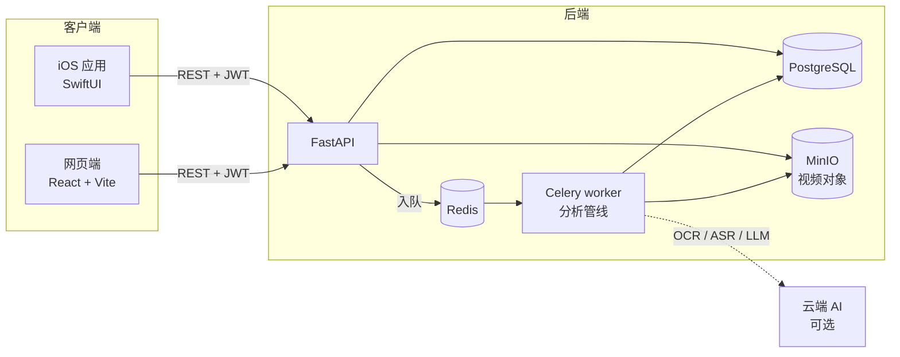

# LivePulse · 脉播

**教练式的 AI 直播复盘工具。** 上传一段直播录屏，得到综合评分、关键时刻和具体的改进建议，不用再熬夜重看几个小时的回放。

[English](README.md) · [简体中文](README.zh-CN.md) · [MIT 协议](LICENSE)

<p align="center">
  
  
  
</p>
<p align="center">
  
  
  
</p>

> 所有截图均为**合成演示数据**（虚构的主播、编写的话术、程序生成的测试视频）。本仓库不包含任何真实主播或平台数据。

## 能做什么

- **复盘工作台**：视频播放器、带高光与笔记标记的时间轴、按时间窗口加载的字幕、AI 洞察，并排呈现。
- **教练式报告**：综合分加互动 / 转化 / 内容三个分项，列出关键时刻，并告诉你下次该改什么。
- **高光时刻**：AI 挑出可分享的片段，可导出成视频切片。
- **跨场进步追踪**：按主播看历次场次的趋势，确认自己是否真的在进步。
- **时间锚笔记**：把笔记钉在时间轴上，并同步到后端。

两个客户端共用一套后端：原生 **iOS 应用**（SwiftUI）和**网页端**（React）。

## 三条命令跑起来（不需要任何 API key）

演示模式会写入几场完全合成、已分析完成的场次，并生成一段短样例视频，全程不调用任何云端 AI。

```bash
git clone https://github.com/kongdezheng347104464-ship-it/livepulse-review.git && cd livepulse-review/livepulse-backend
docker compose -f docker-compose.demo.yml up --build        # 后端 + 数据库 + 对象存储
cd frontend_v2 && npm install && npm run dev                 # 网页端 http://localhost:3002
```

用 `demo@example.com` / `demo-password-123` 登录（公开的、仅限本地的演示账号）。

- 第一次构建要下载 PyTorch 等依赖，需要几分钟。第一次启动还会现场生成一段 11 分钟的样例视频（约 35 MB，不会提交进仓库）。
- 国内访问 PyPI 慢：`docker compose -f docker-compose.demo.yml build --build-arg PIP_INDEX_URL=https://mirrors.aliyun.com/pypi/simple/`
- **iOS**：用 Xcode 打开 `livepulse-app/LivePulse/LivePulse.xcodeproj`，在模拟器里运行。Debug 构建连接 `http://127.0.0.1:8000`。

## 架构



视频分块上传，再通过支持 Range 的预签名链接回传给客户端。分析在 worker 里异步进行，用户可以先进入工作台看视频，结果随后陆续出现。

## 分析管线

一段录屏会经过一张由若干步骤组成的小型图（[`tasks/pipeline.py`](livepulse-backend/backend/app/tasks/pipeline.py)）：

```
阶段 1（顺序）   视频处理 → 帧 + 片段
阶段 2（并行）   ASR 分支：语音识别 → 话术分析 → 早期洞察 → 战术识别
                OCR 分支：画面识别 → 在线人数 → 弹幕分析
阶段 3（顺序）   关联分析 → 评分 → 回放转码
```

值得一看的地方：

- **两级失败模型。** 某一步对整场分析是致命的就抛 `StepError`；管线可以降级继续时抛 `StepSkipped`（比如缺少在线人数序列，就退回更简单的指标）。调度器对两者的处理不同。
- **共享同一个数据库会话的并行分支。** ASR 与 OCR 两个分支用 `asyncio.gather` 并行，计算密集部分在线程里重叠，数据库写入由一把锁串行化。作者实测 16 分钟的视频：ASR 约 46 秒、OCR 约 31 秒并行完成，串行则约 77 秒。
- **逐步骤追踪。** 每一步的状态、耗时和错误都写入独立的表，失败之后能查。启动时，卡在锁定状态又没有存活 worker 的场次会被标成 `error`，让界面可以提供重试。
- **幂等重跑。** 重新分析会清除并重写该场次的派生数据，而不是追加；重建评分时会保留之前算出的早期洞察。
- **写下来的约束。** [`docs/adr/`](livepulse-backend/docs/adr) 记录了设计决策：用间接表归属实现多租户隔离（ADR-0001）、非破坏性重计算（ADR-0002，状态见下文）、以及意图自适应分析，避免拿带货指标去评判教学型主播（ADR-0003）。

另外还有：用单一归属工具函数实现的多租户数据隔离、JWT 鉴权加 argon2 密码哈希、限流、Alembic 迁移、针对 OCR 屏幕文字的关键词 / 问题 / 点赞数提取器，以及可选的本地 faster-whisper 识别模式（`USE_LOCAL_ASR`）。

## 使用真实云端 AI

演示模式之外，分析会调用云服务：画面与语音用**阿里云 OCR 和语音识别**，LLM 默认用**通义千问（DashScope）**。把 `livepulse-backend/.env.example` 复制成 `.env`，填入 key，然后启动完整栈：

```bash
docker compose -f docker-compose.standalone.yml --profile standalone up -d --build
```

还需要 `JWT_SECRET`、`ADMIN_EMAIL`、`ADMIN_PASSWORD` 和 `MINIO_PUBLIC_ENDPOINT`（手机或浏览器能访问 MinIO 的 host:port）。key 绝不要提交，请保持在版本控制之外。

## 测试

```bash
cd livepulse-backend/backend
pip install -r requirements.txt
DATABASE_URL=postgresql+asyncpg://u:p@localhost/x MINIO_ACCESS_KEY=x MINIO_SECRET_KEY=yyyyyyyy \
  PYTHONPATH=. pytest -q tests \
  --ignore=tests/api --ignore=tests/integration --ignore=tests/regression.py --ignore=tests/test_auth_endpoints.py
```

193 个单元测试不需要数据库、对象存储或任何云 key。被排除的是需要在线后端的集成测试。

## 仓库结构

```
livepulse-backend/
  backend/            FastAPI 应用、Celery 管线、Alembic 迁移、测试
  frontend_v2/        React + Vite + Ant Design 网页端
  deploy/             生产环境 compose / nginx 示例
  docs/               设计笔记、ADR、QA 审计、复盘
  docker-compose.demo.yml        演示模式（无需 key）
  docker-compose.standalone.yml  完整栈
livepulse-app/        SwiftUI iOS 应用（无第三方依赖）、设计文档
```

## 适用范围与负责任使用

LivePulse 只分析**你自己上传的录屏**。它不连接任何直播平台的接口，不抓取、也不存储他人的数据。请确保你有权分析所上传的内容，并遵守录屏来源平台的服务条款以及你所在地区的隐私规定。

在非演示模式下，视频画面、音频和字幕会发送给上文提到的云服务商，对多数用户来说这属于数据出境。是否可以接受请你自行判断；[`docs/legal/privacy-policy-draft.md`](livepulse-backend/docs/legal/privacy-policy-draft.md) 提供了一份起点性质（未经法务审阅）的隐私政策模板。

网页端界面中出现的第三方 AI 模型 logo 属于各自权利人的商标，仅用于标明所使用的模型。

## 项目状态与已知局限

这是一个完成度较高的原型，**目前已搁置**。它是在没有做市场验证的情况下做出来的，我没有在动手前验证过需求，如果你想做类似的东西，这一点值得参考。

- OCR 阶段是按某个平台的竖屏布局调的（识别区域和关键词是写死的），换平台需要重新标定。
- 界面、提示词和教练话术都是中文，没有本地化层。
- ADR-0002（非破坏性重计算）已写成约束文档，但"先写暂存再原子替换"的完整实现还没有做完。
- 上传续传在同一次运行内失败重试时可以接着传（服务端把分块存在对象存储里），但 iOS 客户端把 upload id 只放在内存里，强杀应用后这次上传会重新开始。
- 分析管线是每个 worker 进程单槽位，不是为高并发设计的。
- 单租户式启动：只通过环境变量预置一个管理员账号。
- 生产部署文件只是示例，不是加固后的配置。

## 作者

**kong dezheng**：建筑学与女装电商背景，以个人项目的方式、与 AI 结对完成了这个项目的全部工作。欢迎提 issue 和想法；这是作品集项目，回复时间不固定。

采用 [MIT 协议](LICENSE)。第三方模型在运行时按各自的许可证下载（如 Whisper、BGE）；ffmpeg 安装在容器镜像里，不属于本仓库。
