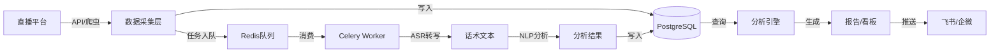
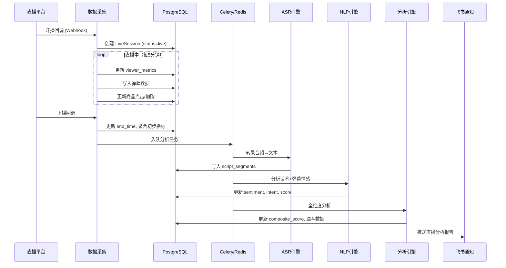

# 美妆直播效果分析系统 — 架构设计文档

> 版本: v1.0 | 日期: 2026-05-21 | 主理人: 齐活林

---

## 1. 系统概述

### 1.1 业务场景
美妆主播进行化妆教学直播，过程中挂小黄车售卖美妆商品。系统需要从**话术、时长、互动、GMV、转化率**五个维度全面评估每场直播的效果。

### 1.2 核心目标
| 维度 | 目标 |
|------|------|
| 话术分析 | 评估主播口播质量、产品推介话术有效性、销售话术转化力 |
| 时长分析 | 统计直播时长、频次、时段分布，关联GMV找最佳时段 |
| 互动分析 | 弹幕量/情感/互动率/粉丝增长，衡量观众参与度 |
| GMV分析 | 成交金额统计、趋势、同比环比、商品贡献度 |
| 转化率 | 观看→互动→点击→下单→成交 全链路漏斗 |

### 1.3 用户角色
| 角色 | 权限 |
|------|------|
| 主播本人 | 看自己所有数据、接收分析报告 |
| 运营/MCN | 看旗下所有主播数据、多主播对比 |
| 管理员 | 系统配置、数据源管理 |

---

## 2. 系统整体架构

```
┌─────────────────────────────────────────────────────────────────┐
│                        展  示  层                                │
│   Web Dashboard (React)  │  PDF报告  │  飞书/企微通知           │
├─────────────────────────────────────────────────────────────────┤
│                        分  析  引  擎  层                        │
│  ┌──────────┐  ┌──────────┐  ┌──────────┐  ┌──────────┐        │
│  │ 话术分析  │  │ 时长分析  │  │ 互动分析  │  │ 转化分析  │        │
│  │ 引擎     │  │ 引擎     │  │ 引擎     │  │ 引擎     │        │
│  └────┬─────┘  └────┬─────┘  └────┬─────┘  └────┬─────┘        │
│       │              │              │              │             │
│  ┌────┴──────────────┴──────────────┴──────────────┴────┐       │
│  │                  统 一 评 分 引 擎                    │       │
│  │           单场评分 / 主播评分 / 商品评分              │       │
│  └──────────────────────────────────────────────────────┘       │
├─────────────────────────────────────────────────────────────────┤
│                        数  据  处  理  层                        │
│  ┌──────────┐  ┌──────────┐  ┌──────────┐  ┌──────────┐        │
│  │ ASR引擎   │  │ NLP引擎   │  │ ETL管道   │  │ 数据清洗  │        │
│  │(语音→文本)│  │(文本分析) │  │(定时任务) │  │(去重/校验)│        │
│  └──────────┘  └──────────┘  └──────────┘  └──────────┘        │
├─────────────────────────────────────────────────────────────────┤
│                        数  据  采  集  层                        │
│  ┌──────────┐  ┌──────────┐  ┌──────────┐  ┌──────────┐        │
│  │ 平台API   │  │ 爬虫采集   │  │ 手动导入   │  │ 实时Webhook│       │
│  │(抖音/快手)│  │(弹幕/商品)│  │(Excel/CSV)│  │(下播回调) │       │
│  └──────────┘  └──────────┘  └──────────┘  └──────────┘        │
├─────────────────────────────────────────────────────────────────┤
│                        基  础  设  施  层                        │
│  PostgreSQL  │  Redis  │  MinIO(OSS)  │  Celery  │  Docker     │
└─────────────────────────────────────────────────────────────────┘
```

---

## 3. 核心模块设计

### 3.1 数据采集模块

**职责**: 多渠道采集直播原始数据

| 子模块 | 数据内容 | 采集方式 | 频率 |
|--------|---------|---------|------|
| 直播元数据采集 | 直播ID、开播/下播时间、标题、封面 | 平台API / 爬虫 | 开播时 + 下播后 |
| 弹幕数据采集 | 弹幕内容、时间戳、用户ID | WebSocket实时流 / 爬虫 | 直播中实时 |
| 商品数据采集 | 挂车商品、价格、库存、销量 | 平台API / 爬虫 | 每5分钟 |
| 成交数据采集 | 订单、GMV、退款 | 平台商家后台API / 导出 | 下播后 |
| 录屏音频采集 | 直播录屏/音频流 | 平台录屏功能 / OBS录制 | 直播全程 |

**关键约束**:
- 弹幕需去重（用户刷屏）
- 成交数据需与场次精确关联
- 国内平台优先对接抖音开放平台API、快手开放平台

---

### 3.2 话术分析引擎

**职责**: 对主播的语音/文本内容进行多维度分析

#### 输入
- 直播音频 → ASR转文本（带时间戳）
- 可直接获取的文本（如口播稿）

#### 处理流程
```
直播音频 → ASR引擎(Whisper/阿里云ASR) → 带时间戳的文本
                                              ↓
                               ┌──────────────┴──────────────┐
                               ↓                             ↓
                          话术分类                          情感分析
                    (产品介绍/促销/互动/闲聊)          (正面/中性/负面)
                               ↓                             ↓
                               └──────────────┬──────────────┘
                                              ↓
                                       话术质量评分
                              (语速/停顿/关键词密度/重复率)
```

#### 分析维度
| 维度 | 指标 | 说明 |
|------|------|------|
| 话术结构 | 开场/暖场/产品介绍/促单/收尾占比 | 评估节奏 |
| 产品话术 | 产品提及次数、单品讲解时长、USP覆盖率 | 卖点传达 |
| 互动话术 | 点名回复率、提问频率、引导关注次数 | 互动质量 |
| 促销话术 | 限时/限量/优惠话术频次、紧迫感指数 | 转化推动 |
| 语言质量 | 语速(字/分钟)、口头禅频率、有效信息密度 | 专业度 |

#### 关键技术
- **ASR**: OpenAI Whisper (本地部署) 或 阿里云实时语音识别
- **NLP**: 中文分词(jieba) + 情感分析(snownlp/bert) + 关键词提取(TF-IDF/TextRank)
- **话术模板库**: 预定义美妆领域话术类型，支持正则 + 语义匹配

---

### 3.3 时长分析引擎

**职责**: 统计直播时长，分析时长与效果的关联

| 指标 | 计算方式 |
|------|---------|
| 实际直播时长 | 下播时间 - 开播时间 - 断播时长 |
| 有效时长 | 有观众在线的时长 |
| 时段分布 | 按小时/星期/月份聚合 |
| 时长-GMV比 | GMV / 直播时长（元/小时） |
| 时段效率 | 各时段 GMV/小时 对比 |

#### 输出
- 时长趋势图（按天/周/月）
- 最佳直播时段推荐
- 时长 vs GMV 散点图 + 回归线

---

### 3.4 互动分析引擎

**职责**: 分析观众参与度和互动质量

| 指标 | 计算方式 | 数据源 |
|------|---------|--------|
| 弹幕总量 | 统计弹幕条数 | 弹幕采集 |
| 弹幕速率 | 弹幕/分钟（分时段） | 弹幕采集 |
| 弹幕情感分布 | 正面/中性/负面占比 | NLP情感分析 |
| 互动率 | 发弹幕UV / 观看UV | 弹幕 + 观看数据 |
| 粉丝增长 | (下播粉丝 - 开播粉丝) / 场次 | 平台API |
| 高价值弹幕 | 含购买意向的弹幕（"怎么买""多少钱"） | NLP分类 |
| 观众留存曲线 | 每分钟在线人数变化 | 平台API |

#### 情感分析分类
- 🟢 **正面**: "好看""买过好用""主播讲得清楚"
- 🟡 **中性**: "这个色号有吗""几点结束"
- 🔴 **负面**: "太贵了""不好用""骗人的"

---

### 3.5 转化率分析引擎（漏斗模型）

**职责**: 构建全链路转化漏斗，定位流失环节

```
    观看人数 (UV)
        │  ↓ 流失
    互动人数 (发弹幕/点赞)
        │  ↓ 流失
    点击商品 (进入商品页)
        │  ↓ 流失
    加入购物车
        │  ↓ 流失
    提交订单
        │  ↓ 流失
    付款成交 (GMV)
```

| 漏斗层级 | 关键指标 |
|---------|---------|
| 曝光→互动 | 弹幕互动率 |
| 互动→点击 | 商品点击率（CTR） |
| 点击→加购 | 加购率 |
| 加购→下单 | 下单率 |
| 下单→成交 | 成交率 / 支付转化率 |

#### 漏斗分时段分析
- 按直播每30分钟切片，看各时段转化效率
- 定位"高光时刻"和"流失节点"

---

### 3.6 GMV分析引擎

**职责**: 成交金额统计和多维分析

| 维度 | 指标 |
|------|------|
| 场次维度 | 单场GMV、环比、同比 |
| 商品维度 | 单品GMV、贡献占比、客单价 |
| 时段维度 | 各时段GMV、时段占比 |
| 主播维度 | 主播GMV排行、场均GMV |
| 漏斗关联 | GMV/观看UV = 千次观看成交额 |

#### 核心图表
- GMV趋势折线图
- 商品贡献帕累托图（二八分析）
- GMV构成桑基图

---

### 3.7 统一评分引擎

**职责**: 综合各维度指标，给每场直播打综合分

```
单场评分 = w1 × 话术得分 + w2 × 互动得分 + w3 × 转化得分 + w4 × 时长效率得分

（权重可配置，默认 w1=0.25, w2=0.2, w3=0.35, w4=0.2）
```

| 评分等级 | 分数范围 | 含义 |
|---------|---------|------|
| S | 90-100 | 顶级直播 |
| A | 75-89 | 优秀 |
| B | 60-74 | 良好 |
| C | 40-59 | 一般 |
| D | 0-39 | 需改进 |

---

## 4. 数据模型设计

### 4.1 核心实体

```
┌──────────────┐       ┌──────────────┐       ┌──────────────┐
│   Anchor     │       │  LiveSession │       │   Product    │
│   (主播)     │ 1──N  │  (直播场次)  │ N──M  │   (商品)     │
├──────────────┤       ├──────────────┤       ├──────────────┤
│ id           │       │ id           │       │ id           │
│ name         │       │ anchor_id    │       │ name         │
│ platform     │       │ platform     │       │ category     │
│ avatar_url   │       │ start_time   │       │ price        │
│ followers    │       │ end_time     │       │ image_url    │
│ created_at   │       │ duration_sec │       │ platform_id  │
└──────────────┘       │ title        │       └──────────────┘
                       │ cover_url    │
                       │ viewer_peak  │
                       │ viewer_avg   │
                       │ total_gmv    │
                       │ total_orders │
                       │ new_followers│
                       └──────┬───────┘
                              │
          ┌───────────────────┼───────────────────┐
          │                   │                   │
   ┌──────┴──────┐    ┌──────┴──────┐    ┌──────┴──────┐
   │  Danmaku    │    │   Script    │    │LiveProduct  │
   │  (弹幕)     │    │  (话术段落) │    │(场次商品)   │
   ├─────────────┤    ├─────────────┤    ├─────────────┤
   │ id          │    │ id          │    │ id          │
   │ session_id  │    │ session_id  │    │ session_id  │
   │ user_id     │    │ start_sec   │    │ product_id  │
   │ content     │    │ end_sec     │    │ clicks      │
   │ timestamp   │    │ text        │    │ add_cart    │
   │ sentiment   │    │ type        │    │ orders      │
   │ intent      │    │ score       │    │ gmv         │
   └─────────────┘    └─────────────┘    └─────────────┘
```

### 4.2 核心表结构（SQL）

```sql
-- 主播表
CREATE TABLE anchors (
    id          UUID PRIMARY KEY DEFAULT gen_random_uuid(),
    name        VARCHAR(100) NOT NULL,
    platform    VARCHAR(20) NOT NULL,  -- douyin, kuaishou, taobao
    avatar_url  TEXT,
    followers   INT DEFAULT 0,
    created_at  TIMESTAMPTZ DEFAULT NOW()
);

-- 直播场次表（核心事实表）
CREATE TABLE live_sessions (
    id              UUID PRIMARY KEY DEFAULT gen_random_uuid(),
    anchor_id       UUID REFERENCES anchors(id),
    platform        VARCHAR(20) NOT NULL,
    platform_room_id VARCHAR(100),      -- 平台侧房间ID
    title           VARCHAR(500),
    cover_url       TEXT,
    start_time      TIMESTAMPTZ NOT NULL,
    end_time        TIMESTAMPTZ,
    duration_sec    INT,                -- 实际直播秒数
    viewer_peak     INT,                -- 峰值观看人数
    viewer_avg      INT,                -- 平均观看人数
    total_danmaku   INT DEFAULT 0,      -- 弹幕总数
    total_gmv       DECIMAL(12,2) DEFAULT 0,
    total_orders    INT DEFAULT 0,
    new_followers   INT DEFAULT 0,
    composite_score DECIMAL(5,2),       -- 综合评分
    status          VARCHAR(20) DEFAULT 'live', -- live, ended, analyzed
    created_at      TIMESTAMPTZ DEFAULT NOW()
);

-- 弹幕表
CREATE TABLE danmakus (
    id          UUID PRIMARY KEY DEFAULT gen_random_uuid(),
    session_id  UUID REFERENCES live_sessions(id),
    user_id     VARCHAR(100),
    content     TEXT NOT NULL,
    timestamp   INT NOT NULL,           -- 相对于开播的秒数
    sentiment   VARCHAR(10),            -- positive, neutral, negative
    intent      VARCHAR(50),            -- purchase_intent, question, praise, complaint
    created_at  TIMESTAMPTZ DEFAULT NOW()
);

-- 话术分析结果表
CREATE TABLE script_segments (
    id          UUID PRIMARY KEY DEFAULT gen_random_uuid(),
    session_id  UUID REFERENCES live_sessions(id),
    start_sec   INT NOT NULL,
    end_sec     INT NOT NULL,
    text        TEXT NOT NULL,
    script_type VARCHAR(30),            -- opening, product_intro, promotion, qa, closing
    speech_rate DECIMAL(5,1),           -- 语速 (字/分钟)
    keywords    TEXT[],                  -- 关键词数组
    product_mentions TEXT[],             -- 提及商品
    score       DECIMAL(5,2),
    created_at  TIMESTAMPTZ DEFAULT NOW()
);

-- 场次-商品关联表（漏斗数据）
CREATE TABLE live_products (
    id          UUID PRIMARY KEY DEFAULT gen_random_uuid(),
    session_id  UUID REFERENCES live_sessions(id),
    product_id  UUID REFERENCES products(id),
    position    INT,                    -- 挂车顺序
    clicks      INT DEFAULT 0,          -- 商品点击
    add_cart    INT DEFAULT 0,          -- 加购
    orders      INT DEFAULT 0,          -- 下单
    gmv         DECIMAL(12,2) DEFAULT 0,
    created_at  TIMESTAMPTZ DEFAULT NOW()
);

-- 商品表
CREATE TABLE products (
    id          UUID PRIMARY KEY DEFAULT gen_random_uuid(),
    platform_product_id VARCHAR(100),
    name        VARCHAR(300) NOT NULL,
    category    VARCHAR(100),
    brand       VARCHAR(100),
    price       DECIMAL(10,2),
    image_url   TEXT,
    created_at  TIMESTAMPTZ DEFAULT NOW()
);

-- 分钟级观众数据（用于留存曲线）
CREATE TABLE viewer_metrics (
    id          UUID PRIMARY KEY DEFAULT gen_random_uuid(),
    session_id  UUID REFERENCES live_sessions(id),
    minute_offset INT NOT NULL,          -- 第几分钟
    viewer_count  INT,
    danmaku_count INT,
    like_count    INT DEFAULT 0,
    gift_count    INT DEFAULT 0,
    created_at  TIMESTAMPTZ DEFAULT NOW()
);
```

---

## 5. 技术栈建议

| 层级 | 技术 | 理由 |
|------|------|------|
| 后端框架 | **FastAPI** (Python 3.11+) | 异步高性能、自动OpenAPI文档、生态成熟 |
| 数据库 | **PostgreSQL 15+** | 关系型核心数据、JSON字段灵活扩展 |
| 缓存 | **Redis** | 实时弹幕缓冲、ASR任务队列、会话缓存 |
| 任务队列 | **Celery + Redis** | 异步处理ASR转录、NLP分析、报告生成 |
| 对象存储 | **MinIO** | 录屏文件、音频文件、图表导出 |
| 前端 | **Vite + React + Ant Design** | 国内生态好用、组件丰富、图表ECharts |
| 可视化 | **ECharts / Apache Superset** | 中文友好、大屏支持好 |
| ASR | **Whisper (本地) / 阿里云ASR (云端)** | 本地免费但需GPU；云端按量付费 |
| NLP | **jieba + snownlp + transformers** | 中文分词+情感分析+BERT |
| 容器化 | **Docker + Docker Compose** | 一键部署 |
| 反向代理 | **Nginx** | 静态资源 + API代理 |
| 通知 | **飞书 Webhook / 企业微信** | 用户已有飞书通知体系 |

---

## 6. 数据流设计

### 6.1 主数据流



### 6.2 一场直播的完整处理流程



---

## 7. API 设计概要

```
POST   /api/v1/webhook/live-start       # 开播回调
POST   /api/v1/webhook/live-end         # 下播回调
GET    /api/v1/sessions                 # 直播场次列表（分页+筛选）
GET    /api/v1/sessions/{id}            # 单场详情（含全维度数据）
GET    /api/v1/sessions/{id}/funnel     # 漏斗数据
GET    /api/v1/sessions/{id}/script     # 话术分析
GET    /api/v1/sessions/{id}/danmaku    # 弹幕分析
GET    /api/v1/anchors/{id}/dashboard   # 主播看板
GET    /api/v1/anchors/{id}/trend       # 趋势数据
GET    /api/v1/products/{id}/analysis   # 商品分析
POST   /api/v1/sessions/import          # 手动导入场次数据
GET    /api/v1/reports/generate         # 生成PDF报告
```

---

## 8. 部署架构

```
┌─────────────────────────────────────────┐
│              Nginx (80/443)              │
│         静态资源 + API反向代理           │
├─────────────────────────────────────────┤
│  ┌─────────────┐  ┌─────────────────┐   │
│  │ React 前端   │  │ FastAPI 后端     │   │
│  │ (Vite Build) │  │ (uvicorn × 4)   │   │
│  └─────────────┘  └────────┬────────┘   │
│                             │            │
│  ┌──────────────────────────┼────────┐   │
│  │     Celery Workers (×2)  │        │   │
│  │  ┌─────────┐ ┌─────────┐ │        │   │
│  │  │ASR Worker│ │NLP Worker│ │        │   │
│  │  └─────────┘ └─────────┘ │        │   │
│  └──────────────────────────┼────────┘   │
│                             │            │
│  ┌──────────┐  ┌────────┐  │            │
│  │PostgreSQL│  │ Redis  │  │            │
│  └──────────┘  └────────┘  │            │
│                             │            │
│  ┌──────────┐               │            │
│  │  MinIO   │               │            │
│  └──────────┘               │            │
└─────────────────────────────────────────┘
```

---

## 9. 分期规划（已根据Q&A + 数据现状调整）

> **关键决策总结**：抖音平台 | 爬虫采集（无API） | OBS本地录制 | 仅OBS视频（无其他数据源） | 云服务器+GPU | 1-3主播 | 下播后离线分析

### Phase 1 — 视频处理流水线 + 基础看板
**现状**：手里只有 OBS 录屏视频文件，无 Excel、无 API、无 GMV 数据  
**前提**：OBS 需录制全屏（画面包含弹幕区，否则弹幕 OCR 不可行）  
**目标**：视频丢进去，自动产出**话术 + 弹幕**双维度分析报告

- [ ] 数据库建表（PostgreSQL）
- [ ] 视频上传管理（OBS视频 → MinIO存储 → 自动关联场次）
- [ ] 视频元数据提取（时长、分辨率、编码格式 → 自动记录开播/下播时间）
- [ ] **双轨预处理**
  - 音频轨：提取 → 分段 → 送入 ASR
  - 视频轨：定时截图弹幕区 → OCR 提取弹幕文字
- [ ] Whisper ASR 部署（GPU服务器，faster-whisper）
- [ ] 弹幕 OCR 引擎（PaddleOCR / Tesseract，识别弹幕区文字）
- [ ] 话术文本生成（音频 → 带时间戳的完整文本）
- [ ] 基础话术分析 v1
  - 话术时间线可视化（什么时间说了什么）
  - 语速分析（总字数 / 时长）
  - 话术分类初版（基于关键词 + LLM 分类：产品介绍/互动/闲聊）
- [ ] 基础弹幕分析 v1
  - 弹幕时间线可视化（什么时间弹幕多）
  - 弹幕量统计（总量、速率、峰值）
  - 弹幕情感分析（正面/中性/负面分布）
  - 话术-弹幕关联（主播说到什么时弹幕暴增）
- [ ] 基础 Web Dashboard（场次列表 + 话术时间线 + 弹幕热力）
- [ ] 飞书通知（分析完成后推送摘要，含话术得分 + 弹幕互动率）

### Phase 2 — 话术深度分析
**目标**：不只"说了什么"，还要知道"说的好不好"

- [ ] 话术分类精细化（开场/产品介绍/促销/答疑/收尾）
- [ ] 产品话术评分：卖点覆盖率、关键词密度、单品讲解时长
- [ ] 销售话术评分：限时/限量/优惠话术频次、紧迫感指数
- [ ] 口头禅 + 重复词检测
- [ ] 停顿分析（沉默时长占比、语速波动）
- [ ] 多场次话术对比（同一主播不同场次话术变化）

### Phase 3 — 数据扩展
**目标**：引入更多维度数据，补全分析能力

- [ ] 弹幕采集（抖音爬虫 or OCR识别OBS画面中的弹幕）
- [ ] 弹幕情感分析 + 购买意向检测
- [ ] GMV/订单数据采集（抖音商家后台爬虫 or 手动录入）
- [ ] 转化漏斗（观看→互动→点击→成交）
- [ ] 综合评分模型（话术 + 互动 + 转化加权）

### Phase 4 — 智能化
**目标**：AI给建议

- [ ] 话术优化建议（基于历史高GMV场次话术特征）
- [ ] 最佳直播时段推荐
- [ ] 异常检测告警
- [ ] PDF自动报告 + 自动发送

---

## 10. Q&A 决策记录

| 问题 | 决策 |
|------|------|
| 直播平台 | **抖音** |
| 数据接入 | **爬虫方案**（无官方API权限） |
| 音频获取 | **OBS本地录制**（本地MP4/MKV文件） |
| 话术重点 | **产品话术 + 销售话术同等重要** |
| 实时性 | **下播后离线分析**（1小时内出报告） |
| 主播规模 | **1-3个主播**（小型MCN团队） |
| 部署环境 | **云服务器 + GPU**（跑Whisper ASR） |
| 现有数据 | **仅有OBS录屏视频**（无Excel、无GMV数据） |
